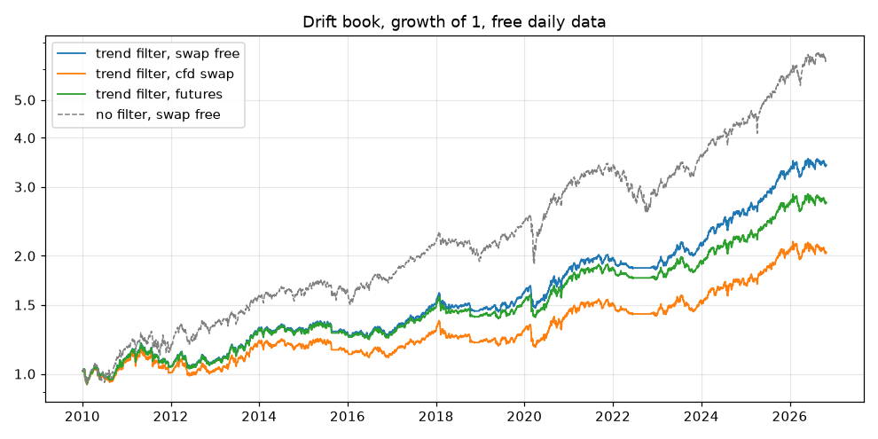

# Drift book on free data

Generated by `python -m drift_book`. Data 2009-01-05 to 2026-10-29 (Yahoo Finance daily closes, in USD).
Returns are a year, compounded. Costs: Costs(trade_bps=2.0, swap_markup=0.025, roll_months=(3, 6, 9, 12)).

| book | period | swap_free return | cfd_swap return | futures return | Sharpe (swap-free) | max drawdown (swap-free) |
|---|---|---:|---:|---:|---:|---:|
| trend filter (D2) | 2010-19 (new, never tested) | +4.9% | +2.6% | +4.4% | 0.63 | -13.7% |
| trend filter (D2) | 2020-21 (out-of-time) | +10.8% | +8.4% | +10.4% | 1.01 | -12.4% |
| trend filter (D2) | 2022-24 (development) | +8.7% | +3.6% | +5.2% | 1.06 | -7.9% |
| trend filter (D2) | 2025 (validation) | +29.2% | +21.9% | +24.4% | 2.52 | -5.3% |
| trend filter (D2) | 2026 to date (hold-out) | +4.8% | -0.5% | +1.4% | 0.44 | -9.3% |
| trend filter (D2) | 2010 to date | +7.6% | +4.3% | +6.2% | 0.87 | -13.7% |
| no filter (D1) | 2010-19 (new, never tested) | +9.3% | +6.1% | +8.6% | 0.89 | -15.9% |
| no filter (D1) | 2020-21 (out-of-time) | +18.1% | +14.9% | +17.7% | 1.10 | -25.2% |
| no filter (D1) | 2022-24 (development) | +8.6% | +1.7% | +4.1% | 0.72 | -24.1% |
| no filter (D1) | 2025 (validation) | +33.1% | +24.6% | +27.6% | 2.30 | -12.5% |
| no filter (D1) | 2026 to date (hold-out) | +12.4% | +5.6% | +8.1% | 0.85 | -11.7% |
| no filter (D1) | 2010 to date | +11.6% | +7.3% | +9.8% | 0.97 | -25.2% |

